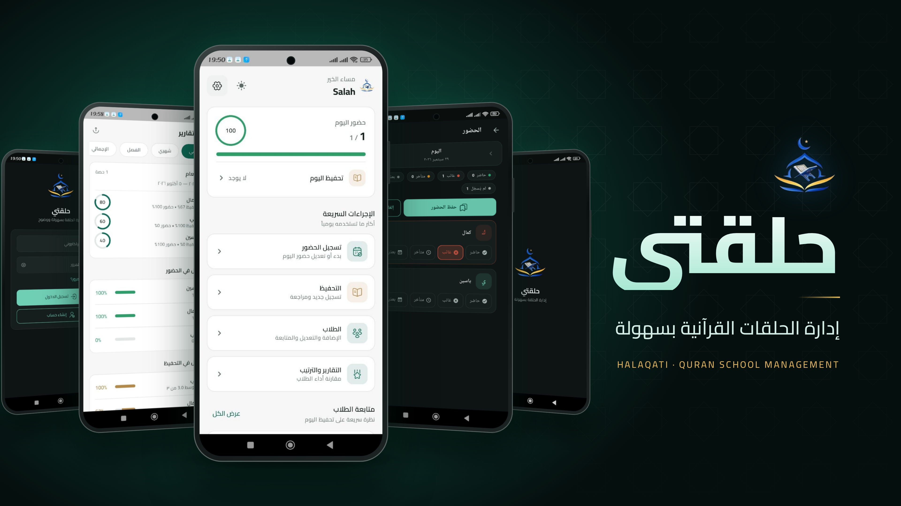

# Halaqati

Halaqati is a production-oriented Flutter app for Quran teachers to manage a single halaqa: student roster, daily attendance, hifd tracking, rankings, and PDF reports.  
The backend is Supabase (Auth + Postgres + Realtime) with Row Level Security (RLS) for tenant isolation.

## Halaqati Preview

<p align="center">
  
</p>
## Quick Start

### Prerequisites

- Flutter SDK (stable, Dart 3.10+)
- A Supabase project
- Android Studio or VS Code

### Setup

1. Install dependencies:
   ```bash
   flutter pub get
   ```
2. Configure Supabase credentials in `lib/core/config/env.dart` with:
   - `supabaseUrl`
   - `supabasePublishableKey` (anon/publishable key only)
3. Open Supabase SQL Editor and run:
   - `supabase/schema.sql`
4. Start the app:
   ```bash
   flutter run
   ```

## Commands

| Command | Description |
|---|---|
| `flutter pub get` | Install project dependencies |
| `flutter analyze` | Run static analysis and lints |
| `flutter test` | Run test suite |
| `flutter run` | Run app in debug mode |
| `flutter build apk` | Build Android release artifact |

## Product Scope

- Teacher onboarding and authentication
- Student management (including soft delete)
- Daily attendance tracking
- Hifd entry and day lock/unlock workflow
- Weighted student ranking by date range
- PDF report generation/sharing

## Architecture

The app follows a layered design:

1. **Presentation** (`lib/screens`, `lib/widgets`, `lib/theme`)  
   UI, navigation, and RTL Arabic experience.
2. **State** (`lib/core/providers.dart`)  
   Riverpod providers orchestrating auth/session, settings, and feature data.
3. **Domain & Services** (`lib/services`)  
   Auth, Supabase data access, ranking calculations, and PDF generation.
4. **Data/Models** (`lib/models`, `supabase/schema.sql`)  
   Typed app models mapped to Postgres tables and constraints.

## Runtime Flow

At startup (`lib/main.dart`):

1. Flutter binding initialization
2. Supabase initialization
3. Surah catalog preload (`surah_aya.json`)
4. App boot with Riverpod `ProviderScope`

Root routing resolves to Login, Onboarding, or Home based on auth/session and teacher profile state.

## Data Model Summary

Key tables:

- `teacher`
- `settings`
- `student` (`active` for soft deletion)
- `attendance` (`unique(student_id, date)`)
- `hifd_entry` (`unique(student_id, date, type)`)
- `hifd_day_lock`

All business rows are tenant-scoped via `teacher_id` and protected by RLS.

## Security

- Supabase RLS enforced on all application tables
- Publishable key only in client; never use `service_role` in app
- Sensitive/local files excluded via `.gitignore`
- Auth/session state isolated per user

## Testing Strategy

- **Unit tests** for business logic (e.g., ranking semantics)
- **Widget/smoke tests** for UI rendering and stability
- **Static analysis** through Flutter lints

Run before release:

```bash
flutter analyze
flutter test
```

## Project Structure

```text
lib/
  core/
    config/
    errors/
    network/
    providers.dart
  data/
  models/
  screens/
  services/
  theme/
  widgets/
supabase/
  schema.sql
test/
```

## Tech Stack

- Flutter + Dart
- Riverpod
- Supabase (Auth, Postgres, Realtime)
- connectivity_plus
- pdf + printing

## Deployment Notes

- Provision Supabase first and apply `supabase/schema.sql`
- Use release builds for distribution (`flutter build apk` / iOS pipeline)
- Keep environment/secrets local and out of Git